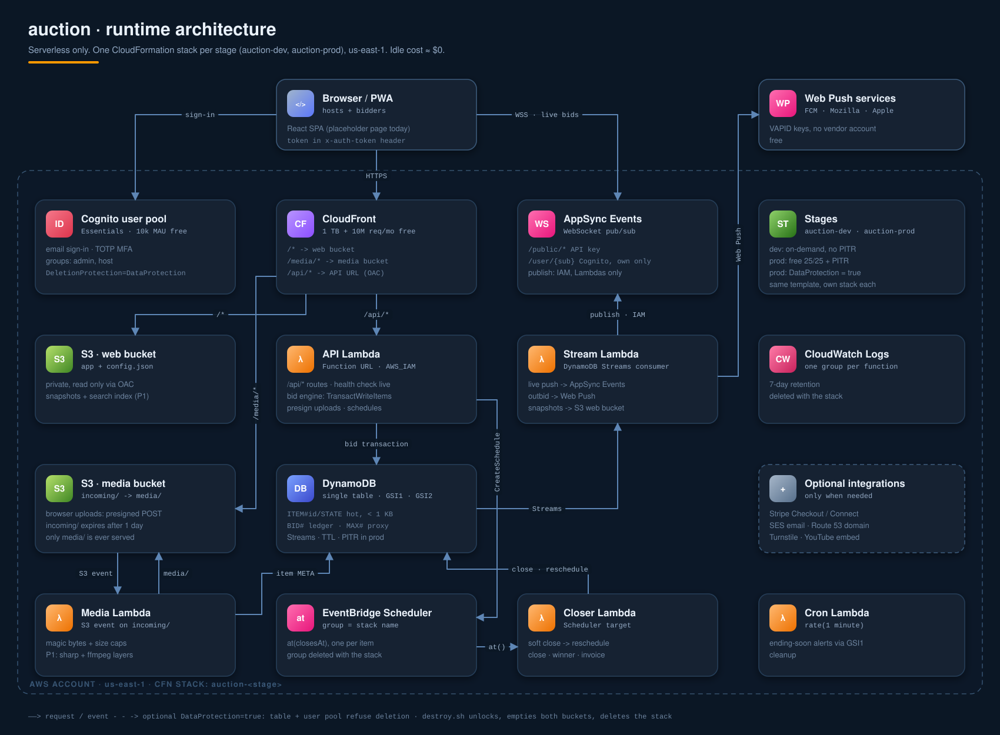
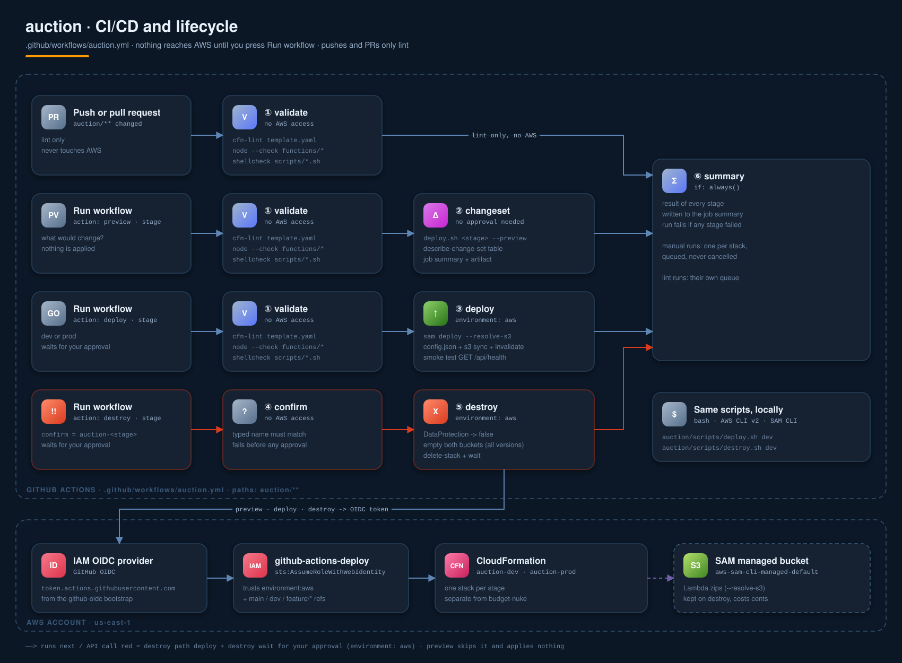

<h1 align="center">🔨 auction</h1>

<p align="center">
  <em>A fully configurable auction platform on AWS serverless. Idle cost ≈ $0.<br/>
  One CloudFormation stack per stage, deployed <strong>and destroyed</strong> from the same pipeline.</em>
</p>

<p align="center">
  
  
  
  
</p>

---

## 🧭 Table of contents

| # | Section |
|---|---|
| 🏗️ | [Architecture](#️-architecture) |
| ✨ | [What owners control](#-what-owners-control) |
| 📁 | [Layout](#-layout) |
| 🧱 | [Resource inventory](#-resource-inventory) |
| 🏷️ | [Stages and parameters](#️-stages-and-parameters) |
| 🔄 | [Pipeline](#-pipeline) |
| 🛠️ | [Setup](#️-setup) |
| 🚀 | [Deploy](#-deploy) |
| 💥 | [Destroy](#-destroy) |
| 📤 | [Outputs](#-outputs) |
| 🔌 | [API](#-api) |
| 🧪 | [Tests](#-tests) |
| ⚠️ | [Gotchas](#️-gotchas) |

---

## 🏗️ Architecture

<p align="center">
  
</p>

The full design is in **[docs/architecture.md](docs/architecture.md)**: services and free tiers, the bid / close / media flows, the data model, the rules engine with every auction setting, the host and bidder features, security, cost, and build phases.

**The request path in one line:** `CloudFront` ⟶ `S3` (app + media) or `Lambda Function URL` (API) ⟶ `DynamoDB` ⟶ `Streams` ⟶ `AppSync Events` (live bids).

---

## ✨ What owners control

Every setting lives in the auction's rules ([architecture §5.1](docs/architecture.md#51-configuration)). The owner edits them in the app's **Owner controls → Rules**, and they are checked on every save.

| Feature | What the owner can do |
|---|---|
| 👁️ **Who sees what** | Give each field an audience: `public`, `registered`, `approved`, `owner` or `group:<name>`. Fields: price, bid count, next minimum, time left, leader, bid list, bid amounts, bidder identities, reserve amount, reserve status, participants. Then override any field per bidder, either way. |
| 📊 **Shared table** | Turn the standings board on or off, choose who sees it, show it only after the close, and pick the columns (rank, bidder, amount, time, status, bids). |
| 💵 **Bid amounts** | Fixed, percent, tiered or bidder's-choice raises with presets, a start price, a reserve, a per-bidder bid limit, and bids entered for a bidder. |
| ✅ **Approve bids** | Hold all bids, or only those at or above a threshold, for approval. Approve, approve a lower amount, or reject. Undecided bids are handled by a deadline rule. |
| ↩️ **Cancel bids** | Void an accepted bid with a reason; price and leader are rebuilt from the rest. |
| 🪙 **Balances** | Credit or debit any bidder, with a reason. The leader's maximum is held, bids over the available balance are refused, and the winner is charged at close. |
| 📜 **History** | Every action is logged: settings changes, approvals, balance changes, cancellations, deleted chat, results. View it in the app, download CSVs. |
| 💬 **Live chat** | One chat per auction. Choose who reads and who posts, slow mode, announcements only, mute bidders, delete messages. |
| 🧾 **Registration** | Automatic or approval, aliases and paddle numbers, groups, block, mute. |
| 🔀 **Formats** | English, sealed first-price, sealed second-price (Vickrey), Dutch, reverse, fixed price. Mix them per item. |
| ⚡ **Buy It Now and offers** | Buy It Now until the first bid, the reserve or the close. Fixed-price listings take offers with auto-accept/decline thresholds and counter-offers. |
| 🔒 **Private auctions** | Public (listed), unlisted (link only), or access code / email invites; outsiders see only the title. |
| 📎 **Media** | Upload images, video, PDFs and 3D models straight to S3; each file is checked and attached to its item. |
| 🧾 **After the sale** | Invoices per buyer, payment instructions, mark paid / shipped / picked up. |
| 📈 **Analytics** | Revenue, sell-through, bids per hour, bidders, watchers, page views. |
| 🗂️ **Templates** | Save rules as templates, clone an auction with its items, import items from CSV, delete drafts and unbid items. |
| 🧭 **Plain forms** | Every setting is a labelled form with help text; only the fields that apply to the chosen auction type are shown. A setting the server rejects is highlighted with the reason. Items get a form too: details as name/value rows and their own settings. Power users can still edit as JSON under Advanced. |
| 🔔 **Bidder tools** | Watchlist, My Bids, an inbox, ending-soon alerts and Web Push. |
| 📱 **Mobile** | Phone and tablet layouts, installable as an app (home screen), tap-twice quick bid at the next minimum, +/− steppers and numeric keypad, vibration when outbid or winning, red countdown in the last minute, a floating chat button with an unread dot, and a resync when the app returns to the foreground or the network comes back. |

> [!WARNING]
> Balances are host-managed credits, settled offline. Real money in and out is stored value and needs a licence; use Stripe for that.

---

## 📁 Layout

The app is self-contained. Nothing here touches `stacks/` or `deploy.yml`, and nothing there touches this folder.

```
auction/
├── template.yaml            🧱 SAM template: the whole app, one stack per stage
├── functions/
│   ├── lib/                 📚 shared by api, stream, closer, cron
│   │   ├── rules.mjs        ⚖️ rules engine: settings, increments, proxy, soft close, approval
│   │   ├── visibility.mjs   👁️ who sees what: every response and push goes through it
│   │   ├── auction.mjs      🔨 business operations, one DynamoDB transaction each
│   │   ├── db.mjs           🗄️ table keys, queries, transactions
│   │   ├── extras.mjs       🧰 watchlist, templates, clone, import, analytics, invoices, uploads
│   │   ├── notify.mjs       🔔 inbox rows + Web Push per event
│   │   ├── webpush.mjs      📬 VAPID + aes128gcm (node:crypto)
│   │   ├── csv.mjs          🧾 CSV reader for imports
│   │   ├── auth.mjs         🔑 Cognito ID-token check (node:crypto)
│   │   ├── aws.mjs          ✍️ SigV4 calls: AppSync Events publish, Scheduler, S3 presigned POST
│   │   └── http.mjs         📨 responses, errors, input checks
│   ├── api/index.mjs        ⚡ /api/* routes
│   ├── media/index.mjs      🖼️ incoming/ → magic-byte check → media/ → attach to item
│   ├── stream/index.mjs     📣 table changes → live events
│   ├── closer/index.mjs     ⏱️ Scheduler target: closes an item, charges the winner
│   └── cron/index.mjs       🔁 every minute: closes missed items, ending-soon alerts
├── web/                     🌐 console: sign-in, bidding, owner controls, live chat
│   ├── index.html
│   ├── app.js
│   ├── rules-form.js        🧭 every setting as a plain-language form
│   ├── dom.js               🧱 DOM builder and the rules merge/diff helpers
│   ├── app.css              📱 responsive: phones ≤ 640 px, tablets ≤ 900 px, safe areas for notched screens
│   ├── manifest.json        📲 install as an app (home screen)
│   ├── icon.svg
│   └── sw.js                🔔 service worker for Web Push
├── test/                    🧪 engine unit tests + API tests on DynamoDB Local
├── package.json             🧪 test dependencies only; nothing ships from node_modules
├── scripts/
│   ├── dev-server.mjs       💻 npm run dev: the console + API on DynamoDB Local, no AWS
│   ├── deploy.sh            🚀 sam deploy → config.json → s3 sync → invalidate → smoke test
│   └── destroy.sh           💥 unlock data → empty buckets → delete stack
├── docs/
│   ├── architecture.md      📐 full design
│   ├── architecture.svg     🏗️ runtime diagram
│   └── pipeline.svg         🔄 CI/CD and lifecycle diagram
└── README.md
.github/workflows/auction.yml  🔄 Run workflow: preview | deploy | destroy (push/PR = lint + test only)
```

The pipeline and a laptop run the **same two scripts**, so a local deploy or destroy behaves exactly like CI.

---

## 🧱 Resource inventory

| Logical ID | Type | Note |
|---|---|---|
| `Table` | `AWS::DynamoDB::Table` | 🗄️ single table, GSI1 + GSI2, Streams, TTL `ttl`, PITR in prod |
| `WebBucket` / `WebBucketPolicy` | `AWS::S3::Bucket` + policy | 🌐 app + `config.json`, readable only by this distribution |
| `MediaBucket` / `MediaBucketPolicy` | `AWS::S3::Bucket` + policy | 🖼️ `incoming/` (expires in 1 day) → `media/` (served) |
| `UserPool` / `UserPoolClient` / `UserPoolDomain` | Cognito | 🔑 Essentials tier, email sign-in, TOTP MFA, hosted domain |
| `AdminGroup` / `HostGroup` | `AWS::Cognito::UserPoolGroup` | 👥 `admin`, `host` |
| `EventsApi` / `PublicNamespace` / `UserNamespace` / `EventsApiKey` | AppSync Events | 📡 `/public/*` for everyone, `/user/{sub}` for its owner only |
| `ScheduleGroup` / `SchedulerRole` | Scheduler + IAM | ⏱️ runtime `at(closesAt)` schedules live here; deleted with the stack |
| `ApiFunction` / `ApiFunctionUrl` / `Api*Permission` | Lambda + URL | ⚡ `AWS_IAM` URL, only CloudFront may call it |
| `MediaFunction` | Lambda | 🖼️ S3 event on `incoming/` |
| `StreamFunction` | Lambda | 📣 DynamoDB Streams consumer |
| `CloserFunction` | Lambda | 🔨 Scheduler target |
| `CronFunction` | Lambda | 🔁 `rate(1 minute)` via Scheduler |
| `*LogGroup` (5) | `AWS::Logs::LogGroup` | 📊 7-day retention, inside the stack so a delete removes them |
| `S3OriginAccessControl` / `LambdaOriginAccessControl` | CloudFront OAC | 🛡️ signs requests to the buckets and the API |
| `SpaRewriteFunction` | `AWS::CloudFront::Function` | 🔀 extension-less paths → `/index.html` |
| `Distribution` | `AWS::CloudFront::Distribution` | 🌍 `/*` web · `/media/*` media · `/api/*` API |

---

## 🏷️ Stages and parameters

| | `auction-dev` | `auction-prod` |
|---|---|---|
| DynamoDB | on-demand (idle = $0) | provisioned 15/15 + 5/5 + 5/5 = the free 25/25 |
| PITR | off | on |
| `DataProtection` | `false` | `true`: table and user pool refuse deletion |
| Deployed by | Run workflow, `stage: dev` | Run workflow, `stage: prod` |

| Parameter | Default | Set by |
|---|---|---|
| `Stage` | — | `deploy.sh <dev\|prod>` |
| `DataProtection` | `true` | `deploy.sh` (from stage); `destroy.sh` flips it to `false` |
| `ApiKeyExpires` | — | `deploy.sh`: today + 360 days, on every deploy |
| `ApiReservedConcurrency` | `0` (no cap) | set by hand to cap API cost and blast radius |

---

## 🔄 Pipeline

<p align="center">
  
</p>

Nothing reaches AWS until someone runs the workflow by hand: **Actions → 🔨 Auction App → Run workflow**. Pushes and PRs only lint and test.

| Trigger | Jobs | Touches AWS? |
|---|---|---|
| 🔀 Push or PR touching `auction/**` | 🔍 validate → 🧾 summary | ❌ lint + test only |
| 🎛️ Run workflow, `action: preview` | 🔍 validate → 📋 changeset → 🧾 summary | 👀 change set only, nothing applied |
| 🎛️ Run workflow, `action: deploy` | 🔍 validate → 🚀 deploy `auction-<stage>` → 🧾 summary | ✅ after your approval |
| 🎛️ Run workflow, `action: destroy` | 🛑 confirm → 💥 destroy `auction-<stage>` → 🧾 summary | 💥 deletes everything, after your approval |

- `validate` needs no AWS access: it runs `cfn-lint`, `node --check`, `shellcheck` and the tests (against a DynamoDB Local service container).
- `deploy` and `destroy` run in the `aws` environment, so they wait for your approval.
- `preview` changes nothing, so it skips the approval. Run it from `main`, `dev` or `feature/*`, the branches the deploy role trusts.

---

## 🛠️ Setup

Nothing new is needed if the budget-nuke setup in the [root README](../README.md#️-setup) is done:

| Needed | Status |
|---|---|
| 🛡️ `github-oidc` bootstrap stack + `AWS_DEPLOY_ROLE_ARN` secret | reused as-is |
| 🚦 GitHub environment `aws` (with required reviewers) | reused as-is |
| 🔒 New secrets or variables | **none** |

For local runs you need AWS CLI v2, SAM CLI, `curl` and bash (Linux, macOS, WSL or Git Bash).

---

## 🚀 Deploy

**Pipeline:** **Actions → 🔨 Auction App → Run workflow → `action: deploy`, `stage: dev|prod`**, then approve. Pushing code alone never deploys.

From a terminal, the same run:

```bash
gh workflow run auction.yml -f action=deploy -f stage=dev    # then approve in Actions
gh workflow run auction.yml -f action=preview -f stage=prod  # change set only, no approval
```

**Local:**

```bash
auction/scripts/deploy.sh dev              # deploy + publish web + smoke test
auction/scripts/deploy.sh prod --preview   # change set only, applies nothing
```

The first create takes about 5–15 minutes, mostly CloudFront. Later deploys take a minute or two. The script ends by calling `GET /api/health` through CloudFront and prints the app URL.

---

## 💥 Destroy

> [!CAUTION]
> Destroy deletes the stage completely: the user pool and every account, the table with all bids, both buckets with every uploaded file, the CloudFront distribution, all functions, schedules and logs. The only safety net is the system backup DynamoDB makes automatically when a PITR-enabled table (prod) is deleted, which it keeps for up to 35 days. Users, media and everything else cannot be recovered.

**Pipeline:** **Actions → 🔨 Auction App → Run workflow →**
- `action: destroy`
- `stage: dev|prod`
- `confirm: auction-<stage>` (the exact stack name).

A wrong confirm fails at once, before anyone is asked to approve. The destroy itself then waits for the `aws` environment approval.

**Local:**

```bash
auction/scripts/destroy.sh dev
```

What the script does, in order:

1. **Unlock:** if `DataProtection=true`, update the stack with `DataProtection=false`, reusing the previous template and parameters. If the stack is stuck in a state that can't take an update (for example `DELETE_FAILED`), it turns off protection on the table and the user pool directly.
2. **Empty:** delete every object, old version and delete marker in both buckets, 1,000 at a time.
3. **Delete:** `delete-stack`, then wait. CloudFront needs ~15 minutes to disable and remove.

If any step fails, fix the cause and run it again. It continues from wherever the last run stopped.

**Left behind on purpose:** the `aws-sam-cli-managed-default` stack and its bucket. They hold the Lambda zips for every SAM app in the account, cost cents, and are recreated if missing.

---

## 📤 Outputs

| Output | Meaning |
|---|---|
| `AppUrl` | 🌍 `https://<id>.cloudfront.net`, the app |
| `DistributionId` | 🌍 for invalidations |
| `WebBucketName` / `MediaBucketName` | 🪣 buckets |
| `TableName` | 🗄️ `auction-<stage>` |
| `UserPoolId` / `UserPoolClientId` / `CognitoDomain` | 🔑 auth config for the web app |
| `EventsHttpDomain` / `EventsRealtimeDomain` / `EventsApiKey` | 📡 live-update endpoints and the public subscribe-only key |
| `ScheduleGroupName` | ⏱️ where item-close schedules go |
| `DataProtection` | 🛡️ current value |

`deploy.sh` writes the browser-facing values to `/config.json` in the web bucket. The page loads them from there, so nothing is hard-coded per stage.

---

## 🔌 API

All routes sit under `/api/auctions/{aid}` unless shown. 👤 = signed in, 👑 = owner only. Every response is filtered for the caller.

| Method and path | Who | Does |
|---|---|---|
| `GET /api/auctions?scope=live\|mine\|joined` | anyone / 👤 | list auctions |
| `POST /api/auctions` | 👤 | create a draft `{ title, description, rules }` |
| `GET` / `PATCH /{aid}` | anyone / 👑 | read; change title, description, rules (timing locked once live) |
| `POST /{aid}/publish` | 👑 | open every item, start the close timers |
| `GET` / `POST /{aid}/items`, `GET` / `PATCH /{aid}/items/{iid}` | anyone / 👑 | items, with per-item rule overrides |
| `POST /{aid}/items/{iid}/bids` | 👤 | bid `{ amount, max?, confirmed?, onBehalfOf? (👑) }`: 201 accepted, 202 pending |
| `GET /{aid}/items/{iid}/bids` | anyone | bid list as the caller may see it |
| `GET /{aid}/items/{iid}/board` | anyone | the standings table, or `null` if hidden |
| `POST /{aid}/items/{iid}/bids/{bidId}/decision` | 👑 | `{ approve, amount?, reason? }` |
| `POST /{aid}/items/{iid}/bids/{bidId}/cancel` | 👑 | `{ reason }` |
| `DELETE /{aid}/items/{iid}/bids/{bidId}` | 👤 | withdraw your own pending bid |
| `POST /{aid}/register` | 👤 | join `{ alias? }` |
| `GET /{aid}/registrations` | 👑 / anyone | all registrations with balances, or the participant list if visible |
| `PATCH /{aid}/registrations/{uid}` | 👑 | `{ status, groups, see, bidLimit, muted, alias, note }` |
| `POST /{aid}/balances/{uid}` | 👑 | `{ delta, reason }` |
| `GET /{aid}/ledger` | 👤 | your ledger (owner: everyone's, or `?uid=`) |
| `GET /{aid}/pending` | 👑 | bids waiting for approval |
| `GET /{aid}/history?before=&limit=` | 👑 | the audit log, newest first |
| `GET /{aid}/export?type=bids\|ledger\|history\|chat` | 👑 | CSV download |
| `GET` / `POST /{aid}/chat`, `DELETE /{aid}/chat/{id}` | per chat rules | read (`?after=` to catch up), post, delete |
| `DELETE /{aid}` | 👑 | delete a draft |
| `POST /{aid}/clone` | 👑 | `{ title?, withItems? }` → new draft |
| `POST /{aid}/items/import` | 👑 | `{ csv }`: all rows or none |
| `DELETE /{aid}/items/{iid}` | 👑 | items without bids or offers |
| `POST /{aid}/items/{iid}/uploads` | 👑 | `{ contentType, size }` → presigned S3 POST |
| `POST /{aid}/items/{iid}/buy` | 👤 | Buy It Now / fixed price |
| `GET` / `POST /{aid}/items/{iid}/offers` | 👤 | list (owner: all, buyer: own); offer `{ amount, message? }` |
| `POST …/offers/{oid}/decision` · `…/respond` · `DELETE …/offers/{oid}` | 👑 · 👤 · 👤 | accept/decline/counter · answer a counter · withdraw |
| `POST` / `DELETE /{aid}/items/{iid}/watch` | 👤 | watch / unwatch |
| `PATCH /{aid}/items/{iid}/result` | 👑 | `{ payment: { status }, fulfillment: { status, tracking? } }` |
| `GET /{aid}/invoices` · `GET /{aid}/analytics` | 👤 / 👑 · 👑 | invoices per buyer · analytics |
| `GET /api/me/bids` · `/api/me/watchlist` · `/api/me/notifications` | 👤 | my bids, watchlist, inbox |
| `POST` / `DELETE /api/me/push`, `GET /api/push/key` | 👤 | Web Push subscription; the VAPID public key |
| `GET` / `POST /api/templates`, `DELETE /api/templates/{id}` | 👤 | saved rules |
| `GET /api/rules/defaults` | anyone | every setting with its default, for the settings forms |

Live channels: `/public/auction/{aid}` (item updates, results, chat or chat pings) and `/user/{sub}` (outbid, won, bid decided, balance changed, owner alerts).

---

## 🧪 Tests

```bash
cd auction
npm install
npm run dynamodb        # DynamoDB Local in Docker, or run DynamoDBLocal.jar on port 8000
npm test                # engine + visibility unit tests, then the API end to end
npm run dev             # the console on http://localhost:5173 against DynamoDB Local
```

`npm run dev` runs the real API handler and the web console with a local test sign-in (any name) and closes due items every 10 seconds. Live updates and Web Push are off locally. It is for your machine only: anyone who can reach the port can sign in as anyone.

The API tests drive the real handler against DynamoDB Local: rules validation, registration approval, proxy bids, approvals with a lowered amount, balance holds and charges, visibility masks and per-bidder overrides, the board, chat with slow mode, mute and delete, bid cancel and replay, closing with the approval grace period, history and CSV export. Without a database on `DYNAMODB_ENDPOINT` (default `http://localhost:8000`) they are skipped. In CI they are required.

---

## ⚠️ Gotchas

- **Budget-nuke.** In the same account as `budget-nuke`, this app is **not** protected by its keep filters, so a live nuke deletes it. Run production in its own AWS account (see [architecture §8](docs/architecture.md#8-cost)).
- **Auth header.** CloudFront OAC overwrites `Authorization`. Send the Cognito token in `x-auth-token`.
- **POST/PUT bodies.** Include `x-amz-content-sha256: <hex sha256 of body>`, or the Lambda URL rejects the request.
- **Public API key.** It expires 365 days after it was last refreshed. Every deploy moves it to +360 days. Deploy at least once a year, or the public live feed stops.
- **Previews.** A preview against a stack that doesn't exist yet leaves an empty `auction-<stage>` in `REVIEW_IN_PROGRESS`. The next deploy (or `destroy.sh`) clears it.
- **Concurrency quota.** New accounts may have a Lambda concurrency quota of 10. Raise it before you set `ApiReservedConcurrency`.
- **No bundling.** The functions import `@aws-sdk/*` from the Lambda Node.js runtime and use `node:crypto` for JWTs and SigV4, so `sam deploy` zips `functions/` as-is. `node_modules/` is for tests only.
- **Members-only chat.** The public live channel carries only a `chat_ping` for it; the browser fetches the messages from the API. That costs one small API call per member per message.
- **Missed timers.** If a close schedule fails, the every-minute cron closes the item, so a close can run up to a minute late.
- **Web Push contact.** Set the repository variable `AUCTION_PUSH_CONTACT` (a real `mailto:` or `https:` URL) before relying on push; some push services reject the `mailto:admin@example.com` default.
- **VAPID key.** The Web Push key pair is generated on first use and stored in the table (`CONFIG` / `VAPID`), readable only by the stack's roles. Destroying the stack deletes it, so browsers must re-enable push after a redeploy.
- **iPhone push and icons.** iOS delivers Web Push only to the app added to the home screen (iOS 16.4+), not to a Safari tab. iOS also ignores SVG home-screen icons; add a 180×180 `apple-touch-icon.png` to `web/` for a sharp icon there.
- **Uploads.** Files appear on the item a few seconds after upload, once the media function has checked them. Rejected files are deleted silently (see the media log group).
