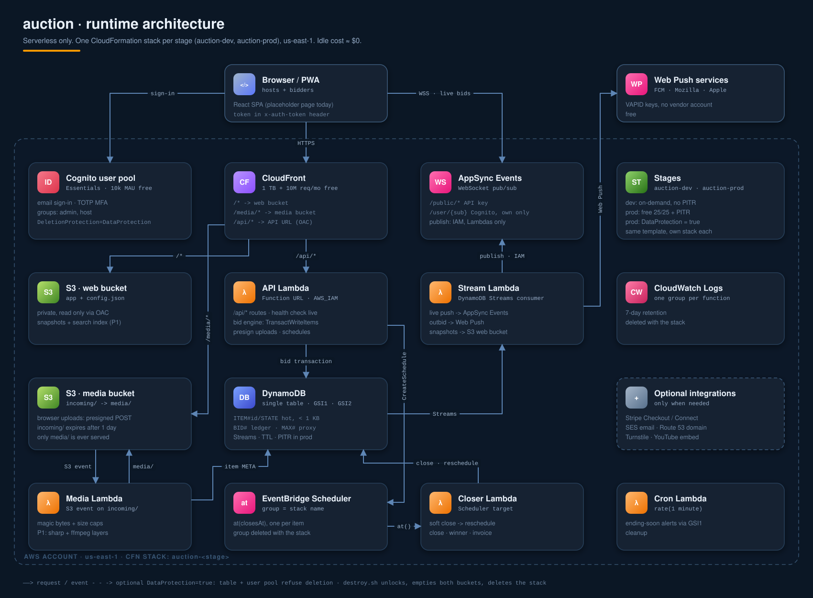
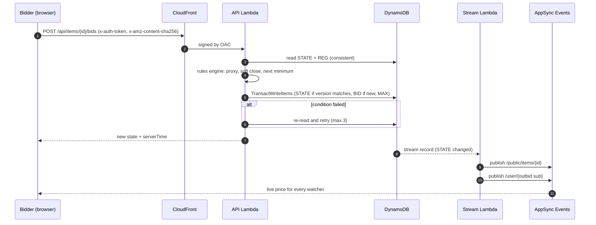

# Auction platform: architecture and design

A web application where anyone can host an auction, list items with photos, video and documents, and set every rule of how the auction runs. Bidders get one place that shows everything they are allowed to see. The hard constraint: hosting on AWS must cost close to nothing.

> **Status:** the infrastructure in [`../template.yaml`](../template.yaml) builds everything in this document. The function code is a skeleton: health check, upload validation, and stubs for the rest. [§11](#11-implementation-status) maps each part of the design to what exists today.

<p align="center">
  
</p>

## Contents

1. [Cost target](#1-cost-target)
2. [Architecture](#2-architecture)
3. [Core flows](#3-core-flows)
4. [Data model](#4-data-model)
5. [Rules engine](#5-rules-engine)
6. [Features](#6-features)
7. [Security and abuse](#7-security-and-abuse)
8. [Cost](#8-cost)
9. [Outside services, only when needed](#9-outside-services-only-when-needed)
10. [Build phases](#10-build-phases)
11. [Implementation status](#11-implementation-status)

---

## 1. Cost target

- Serverless only, in one region (`us-east-1`). No VPC, EC2, ALB, NAT or RDS.
- With no traffic, the app costs a few cents a month for S3 storage.
- Small real use (about 1,000 monthly users, 2,000 items, 20,000 bids a month) costs about $1–3 a month. Most of that is media storage.
- The only outside service you truly need is a payment processor, and only if money passes through the platform.

---

## 2. Architecture

### Services

| Layer | Service | Free allowance | Note |
|---|---|---|---|
| Web hosting | S3 + CloudFront (OAC) | Always free: 1 TB out, 10M requests/month | Cheaper than Amplify Hosting |
| API | One Lambda for all routes, behind CloudFront → Lambda Function URL (OAC) | Lambda: 1M requests + 400k GB-s/month, always free | No API Gateway fee. POST/PUT must send `x-amz-content-sha256` |
| Auth | Cognito user pool (Essentials tier) | 10k MAU free, does not expire | Email sign-in, TOTP MFA; social login and passkeys later |
| Database | DynamoDB single table | Provisioned: 25 WCU + 25 RCU + 25 GB, always free | prod uses provisioned (table + GSIs total 25/25); dev uses on-demand |
| Live updates | AppSync Events (WebSocket pub/sub) | 12 months free, then $1/M operations + $0.08/M connection-minutes | No connection table to manage |
| Timers | EventBridge Scheduler, one-time `at()` schedules | 14M invocations/month | Closes items, sends reminders |
| Media processing | Lambda (arm64) | Uses the Lambda free compute | sharp and ffmpeg layers in phase 1. No MediaConvert |
| Background jobs | DynamoDB Streams → Lambda | Stream reads by Lambda triggers are free | Fan-out, snapshots, search index |
| Push alerts | Web Push (VAPID keys) sent from Lambda | $0, no vendor account | iOS needs the PWA installed (iOS 16.4+) |
| Email | SES, optional | $0.10 per 1,000 emails | Needs a domain. Cognito's built-in email is capped at 50/day |
| Secrets and config | SSM Parameter Store, standard tier | Free | Secrets Manager costs $0.40 per secret |
| Logs and tracing | CloudWatch Logs (7-day retention), X-Ray | 5 GB logs, 10 metrics, 10 alarms, 100k traces | One log group per function, inside the stack |

### Avoid (they charge a fixed monthly fee)

- NAT Gateway (~$32/month)
- Application Load Balancer (~$16/month and up)
- RDS or Aurora
- OpenSearch
- EC2 and public IPv4 addresses ($3.60/month each)
- WAF on pay-as-you-go pricing ($5+ per web ACL per month)
- KMS customer-managed keys ($1/month each)
- Secrets Manager
- IVS and MediaConvert
- Lambda inside a VPC, and provisioned concurrency

### Free-tier caveat

AWS accounts opened after 2025-07-15 get $100–200 of credits for a 6-month free plan instead of the old 12-month free offers. The "always free" allowances above apply to every account.

---

## 3. Core flows

### 3.1 Placing a bid (the part that must be correct)

1. The client sends `POST /api/items/{id}/bids` with `{amount, maxAmount?, reqId}`.
2. The API Lambda checks the Cognito JWT (sent in `x-auth-token`, see §7), using `aws-jwt-verify` with the JWKS cached. It reads `ITEM#id / STATE` and the bidder's `REG#uid` row with strongly consistent reads. Auction rules are cached in memory, keyed by rules version.
3. The rules engine (§5) works out the new state: proxy bids, soft-close extension, next minimum bid.
4. One `TransactWriteItems` call:
   - updates `STATE` only `IF version = :v AND status = 'open' AND closesAt > :now`
   - puts the `BID#` row `IF attribute_not_exists`, using `reqId` so a retried request is never counted twice
   - puts `MAX#uid` when the bid is a proxy bid.
5. If a condition fails, the Lambda re-reads, re-runs the engine and retries up to 3 times. Every reply carries the fresh state and `serverTime`.

The server clock decides. A bid counts only if its write commits before `closesAt`. The close timer only finalizes the result, so a late timer can never let a late bid in.



### 3.2 Closing and anti-sniping

- On publish, the API creates one Scheduler schedule per item: `at(closesAt)` with `ActionAfterCompletion: DELETE`, in the stack's schedule group.
- **Soft close:** a bid inside the last `windowSec` sets `closesAt = now + extendSec`, up to `maxExtensions` times. The Closer still fires at the old time, sees the later `closesAt`, and creates a new schedule for itself. Bids never have to update a schedule.
- **Closer Lambda:**
  1. Switches `open → closed` with a conditional write.
  2. Decides the result: winner, "reserve not met" or "no bids". For sealed formats it reveals and ranks the bids; in a second-price (Vickrey) auction the winner pays the second-highest bid.
  3. Writes `RESULT` and the invoice.
  4. Schedules the payment deadline. If the winner doesn't pay, the item goes to a second-chance offer, then gets relisted.
- **Staggered lots:** `closesAt = auction.closesAt + index × staggerSec`.
- **Dutch:** price is computed as f(now) from start price, step, interval and floor, so nothing is written until someone accepts. The first conditional write wins.
- **Cron Lambda** (every minute, ~43,200 runs/month, free): sends "ending in 15 minutes" alerts to watchers and cleans up.

### 3.3 Media

1. The host calls `POST /api/uploads`. The API checks the user's quota and the file-type allowlist, then returns a presigned POST with `content-length-range`, or presigned multipart for video. The target key is `incoming/{uid}/{uuid}`.
2. The browser shrinks files before upload: images to ≤2560 px, and video through WebCodecs where the browser supports it.
3. An S3 event on `incoming/` triggers the Media Lambda:
   - checks magic bytes against the allowlist and enforces the size caps (exists today)
   - images: strips EXIF/GPS, makes WebP + AVIF at 320/800/1600 px (phase 1, sharp)
   - video: ffprobe, caps at ≤3 min and 720p, transcodes only if not H.264/AAC, adds `+faststart`, takes a poster frame (phase 1, ffmpeg)
   - other files: PDF, CSV, GLB and audio are allowed.
4. Files are served through CloudFront `/media/*` with `immutable` caching for 1 year.
   - Private auctions use CloudFront signed cookies.
   - Documents are sent with `Content-Disposition: attachment`.
   - HTML and SVG are never served inline.
5. S3 lifecycle rules:
   - `incoming/` expires after 1 day
   - incomplete multipart uploads are aborted after 1 day
   - originals of ended auctions are deleted or moved to Glacier Instant Retrieval.

Long videos and livestreams go in as YouTube/Vimeo embeds, which cost $0.

Supported media: images, video, audio, PDF condition reports and certificates, 3D `.glb` (shown with `<model-viewer>`), 360° spins (image sequences), and links.

### 3.4 Reads and live push

- **AppSync Events channels:**
  - `/public/auction/{auctionId}`: subscribe with the public API key, so logged-out visitors also see live prices. It carries item state (public fields only), results and chat. A members-only chat sends a `chat_ping` instead of the message, and members fetch it from the API, which applies their visibility.
  - `/user/{sub}`: Cognito auth, plus an `onSubscribe` handler that rejects any path other than the subscriber's own.
- **Publishing:** only Lambdas publish (IAM auth). The Stream Lambda publishes, not the API Lambda, so fan-out never slows a bid.
- **Read-heavy pages:** item and catalog details are written as JSON snapshots to S3 and served by CloudFront, so browsing uses zero Lambda or DynamoDB reads. Only the live state is dynamic. A CloudFront-cached `/state` endpoint is the polling fallback.
- **Search:** rebuild a MiniSearch index JSON per catalog and search on the client. This holds up to about 10–20k active items. Beyond that, paid search (OpenSearch or Algolia) is needed.
- **Share links:** write a static `/a/{slug}/index.html` with Open Graph tags at publish time, so link previews work without server rendering.

---

## 4. Data model

Single table `auction-<stage>`, keys `PK` / `SK`.

| PK | SK | Holds |
|---|---|---|
| `USER#uid` | `PROFILE` | alias, verification flags, rating, Stripe ids, notification settings |
| `USER#uid` | `PUSH#hash` | Web Push subscription (TTL) |
| `USER#uid` | `WATCH#iid` | watchlist |
| `USER#uid` | `BIDON#iid` | "my bids", written by the Stream Lambda, not on the bid path |
| `AUC#aid` | `META` | host, status, schedule, versioned rules, terms |
| `AUC#aid` | `ROLE#uid` | co-host, clerk, consignor |
| `AUC#aid` | `REG#uid` | registration: status (pending/approved/blocked), alias, paddle, groups, per-field visibility overrides, bid limit, mute, last chat time |
| `AUC#aid` | `BAL#uid` | balance, available, committed (held for leading bids), version |
| `AUC#aid` | `LEDGER#uid#ts` | append-only balance change: credit, debit or charge, with reason and who |
| `AUC#aid` | `LOG#ts` | append-only audit row: actor, action, target, details |
| `AUC#aid` | `CHAT#ts` | chat message: author, role (host/bidder), text, deleted flag |
| `AUC#aid` | `PENDING#bidId` | marker for a bid waiting for approval (the owner's queue) |
| `AUC#aid` | `STAT#yyyy-mm-dd` | page views per day (analytics) |
| `AUC#aid` | `ITEM#iid` | title, description, custom fields, media, rule overrides (cold data) |
| `ITEM#iid` | `STATE` | price, nextMin, leader, leader's maximum and balance hold, count, pending count, closesAt, extensions, version, status (hot data, under 1 KB) |
| `ITEM#iid` | `BID#ts-id` | every bid ever placed, with its maximum and status: pending, accepted, rejected, withdrawn or cancelled. Rows are never deleted |
| `ITEM#iid` | `OFFER#…` / `Q#…` | best offers, Q&A |
| `ITEM#iid` | `RESULT` | outcome (sold, reserve not met, no bids), how (auction, buy_now, offer), winner, price, amount charged, payment and delivery status |
| `ITEM#iid` | `SEALED#uid` | a bidder's current sealed bid and its balance hold |
| `ITEM#iid` | `OFFER#ts-id` | fixed-price offer: amount, message, status (pending, countered, accepted, declined, withdrawn), counter-offer |
| `ITEM#iid` | `WATCHER#uid` | who watches the item, and whether the ending-soon alert went out |
| `USER#uid` | `WATCH#iid` / `BIDON#iid` | the user's watchlist and "my bids" pointers |
| `USER#uid` | `NOTE#ts-id` | inbox notification (TTL 30 days) |
| `USER#uid` | `PUSH#hash` | a browser's Web Push subscription |
| `USER#uid` | `TEMPLATE#id` | saved auction rules |
| `CONFIG` | `VAPID` | the Web Push key pair, made on first use |

**Why `STATE` is its own row:** DynamoDB bills an update on the larger of the old and new item size. A 4 KB item would cost 4 WCU per bid; the small `STATE` row costs 1 WCU (2 inside a transaction).

**GSIs (sparse, `KEYS_ONLY`):**

| Index | Partition | Sort | Used for |
|---|---|---|---|
| `GSI1` | `GSI1PK = STATUS#open` | `GSI1SK = closesAt` | ending soon, cron sweep of overdue items |
| `GSI1` | `GSI1PK = AUC#live` | `GSI1SK = createdAt` | list of live auctions |
| `GSI2` | `GSI2PK = HOST#uid` | `GSI2SK = createdAt` | host dashboard |
| `GSI2` | `GSI2PK = MEMBER#uid` | `GSI2SK = createdAt` | auctions a user joined |

The leader's proxy maximum lives on `STATE` only. A bidder who is outbid has spent their maximum, so no other maximum is ever needed.

**Capacity:**
- **prod:** table 15/15, GSI1 5/5, GSI2 5/5, which is exactly the free 25/25. That gives about 5 bids/s sustained, plus 300 s of burst credit. For a big event day, switch to on-demand: 1M bids ≈ $4.
- **dev:** on-demand. It costs $0 when idle and doesn't eat production's free capacity.

`ttl` is the TTL attribute. Streams carry new and old images. PITR is on in prod.

---

## 5. Rules engine

All rules live in one shared TypeScript package with a pure function:

```
evaluateBid(state, rules, bid, now) -> { accepted, newState, events }
```

The browser uses it to show "next bid ≥ $X" and to preview a bid. The API Lambda runs the same code as the final authority, so the two can never disagree. The package is easy to test with property-based tests.

### 5.1 Configuration

The config is set per auction and validated on every save: an unknown key or a bad value is a 400 that names the setting. Items can override `price`, `increment`, `proxy`, `bidApproval` and their own `opensAt` / `closesAt`. The owner can also set a bid limit, groups and visibility overrides per bidder. These are the defaults (`functions/lib/rules.mjs`):

```yaml
format: english
timing:
  opensAt: null             # null = when published
  closesAt: null            # required before publishing (auction or item)
  staggerSec: 0             # item N closes N × staggerSec later
  softClose: { windowSec: 120, extendSec: 120, maxExtensions: 30 }
price: { currency: USD, start: 1, reserve: null }
increment:
  mode: fixed               # fixed | percent | tiered | bidder_choice
  fixed: 1
  percent: 5
  roundTo: 1
  tiers: [{ upTo: 100, step: 5 }, { upTo: 1000, step: 25 }, { upTo: null, step: 100 }]
  bidderChoice: { min: 1, max: null, presets: [1, 5, 10] }
  confirmAbovePct: 50       # fat-finger guard; 0 = off
proxy: { enabled: true, hostSeesMax: false }
registration: auto          # auto | approval
bidApproval:
  mode: none                # none | above | all
  threshold: 0              # mode above: bids or maximums at or over this wait for the owner
  adjust: lower             # none | lower | any: may the owner change the amount when approving
  decideWithinSec: 900      # pending bids can still be decided this long after the close
  onTimeout: reject         # reject | approve
balance:
  enabled: false
  enforce: true             # refuse bids the available balance can't cover
  unit: credits
  allowNegative: false      # may the owner debit below zero
  startingCredit: 0         # credited once, when a registration is approved
  showToBidder: true
limits: { bidLimit: null }
visibility:                 # public | registered | approved | owner | group:<name>
  price: public
  bidCount: public
  nextMin: public
  closesAt: public
  leader: registered        # whether someone leads, and who (masked unless historyIdentities)
  history: registered       # the bid list
  historyAmounts: registered
  historyIdentities: owner  # real alias/paddle instead of "Bidder 1, 2, 3"
  reserveAmount: owner
  reserveStatus: public
  participants: owner
identity: alias             # alias | paddle | name, for revealed bidders
board:
  enabled: true             # the shared standings table
  audience: registered
  when: always              # always | after_close
  columns: [rank, bidder, amount, time, status]   # also: bids
chat:
  enabled: true
  read: registered
  post: approved
  identity: alias
  slowModeSec: 2
  maxLength: 500
  hostOnly: false           # announcements only
conduct: { hostCanBid: false }
```

Amounts are whole units (dollars or credits), so there is no rounding drift.

Phase 2 adds these settings (defaults shown):

```yaml
format: english             # english | sealed_first | sealed_second | dutch | reverse | fixed_price
price:
  buyNow: { amount: null, until: first_bid }        # english; until first_bid | reserve_met | close
  dutch: { start: null, step: 1, everySec: 60, floor: 1 }
  offers: { enabled: false, autoAccept: null, autoDecline: null }   # fixed_price
access:
  mode: public              # public (listed) | unlisted (link only) | code (access code or invite)
  code: null
  invites: []               # emails that may join without the code
payment: { instructions: '', dueHours: 72 }        # shown to winners; settled offline
```

Items can also override `format`, so one auction can mix English, sealed, Dutch and fixed-price lots. Invalid combinations are refused: Dutch and fixed price can't use bid approval, reverse can't use balances, Buy It Now is English only, offers are fixed price only.

**Still on the roadmap:** Japanese, candle and multi-unit formats, deposits and card holds, eligibility checks (MFA, card on file, country, age), buyer's premium, tax, shipping costs, retraction windows and per-minute bid caps.

**Increment modes:**
- `fixed` and `percent`
- `tiered`: a step table by price band, house style
- `bidder_choice`: the bidder picks the raise, within the host's min/max, with preset buttons
- a confirmation for unusually large jumps.

### 5.2 Proxy bids

A new maximum `Mn` against the current leader's maximum `Ml`:

- If `Mn > Ml`, the new bidder leads at `min(Mn, Ml + inc(Ml))`.
- Otherwise the leader stays, at `min(Ml, Mn + inc(Mn))`. A tie goes to the earlier bid.
- If the leader's maximum is at or above the reserve, the price jumps up to the reserve.

After that, apply the soft-close rule and set `nextMin = price + inc(price)`.

### 5.3 Formats

| Format | How it works |
|---|---|
| English timed | Ascending bids until the close time, optional soft close |
| Live / hybrid | Auctioneer console runs the lots. A clerk enters floor and phone bids. Absentee maximums are loaded beforehand |
| Sealed first-price | Hidden bids; the highest pays what they bid |
| Sealed second-price (Vickrey) | Hidden bids; the highest pays the second-highest bid |
| Dutch | Price falls on a clock; the first to accept wins |
| Reverse | Lowest bid wins (procurement, services) |
| Japanese | Ascending clock; bidders confirm each level or drop out |
| Candle | Random hidden end time inside a window, so sniping doesn't work |
| Multi-unit | N identical units, top N bids win, pay-as-bid or one uniform price |
| Lots and bundles | Several items sold as one |
| Buy It Now | Fixed price that ends the auction |
| Make Offer | Accept, counter or decline, with auto thresholds |
| Fixed price | Plain listing |
| Charity / silent | QR code per item, mobile bidding, fund-a-need donations |

Skip penny/bid-fee auctions: they carry gambling-law risk.

**Built:** English timed, sealed first-price, sealed second-price, Dutch, reverse, Buy It Now, Make Offer and fixed price. Japanese, candle, multi-unit, lots/bundles and live auctioneer mode are not built yet.

- **Sealed:** one hidden bid per bidder; a new bid replaces the old one. Nobody, the owner included, sees amounts, the leader or the standings until the close. Each bid holds its amount from the balance; at close the losers are released and the winner is charged.
- **Dutch:** the price is computed from the clock (`start - steps × step`, never below `floor`), so no timer or push is needed for each drop. The first acceptance buys at the current price and closes the item in the same transaction.
- **Reverse:** the next bid must be at most `price - step`; the lowest bid leads; the reserve is the budget ceiling. The winner is paid offline, so balances are off.
- **Buy It Now:** available until the first bid, until the reserve is met, or until the close (while the price is below it). Buying closes the item, charges the buyer and releases the leader's hold; any pending bids are rejected.
- **Offers:** the buyer offers a price; at or over `autoAccept` it sells at once, under `autoDecline` it is declined at once, otherwise the owner accepts, declines or counters, and the buyer can accept a counter. One open offer per buyer per item.

### 5.4 Bid approval

With `bidApproval.mode` set to `above` (by amount or maximum) or `all`, a bid is checked against the rules when it is placed but not applied:

1. It is stored as `pending`, a `PENDING#` marker joins the owner's queue, and the owner gets a live alert.
2. The owner approves or rejects it. With `adjust: lower` (or `any`) the owner may approve a different amount; the bid keeps what was asked as `originalAmount`.
3. Approval re-runs the engine against the state at that moment. If the bid is no longer valid (for example it is now below the minimum), the owner is told why and can reject it.
4. A bid placed before the close can still be decided until `closesAt + decideWithinSec`. The closer waits for that deadline, applies `onTimeout` to whatever is still pending, then closes the item.

Bids the owner enters for a bidder (`onBehalfOf`) never wait for approval. Bidders can withdraw their own pending bids. Maximum bids are off while `mode: all`, because an automatic raise can't wait for a human.

The owner can also cancel an accepted bid, with a reason. The price and leader are then rebuilt by replaying the remaining accepted bids in the order they were accepted.

### 5.5 Balances

With `balance.enabled`, each bidder has a balance per auction that the owner controls:

- **Credit and debit:** the owner adds or subtracts any amount, with a reason. Every change is an append-only `LEDGER` row with who, why and the balance after.
- **Holds:** the current leader's maximum is held (moved from `available` to `committed`) and released when they are outbid. The hold moves in the same transaction as the bid, so it can never drift.
- **Enforcement:** with `enforce`, a bid whose maximum is more than the available balance is refused.
- **Winning:** at close, the hold is released and the price is charged, as one `charge` ledger row.

> [!WARNING]
> Balances are host-managed credits, settled offline. If bidders pay real money in and can take it out, that is stored value / money transmission and needs a licence. For real money use Stripe (§9).

---

## 6. Features

### 6.1 Host

- **Setup wizard:** format → schedule → rules → eligibility → fees/payment → shipping → items → preview → publish. Save as a template, or clone an auction.
- **Items:**
  - bulk CSV import
  - drag-and-drop bulk media, matched to items by filename or SKU
  - custom field definitions (condition, dimensions, provenance…)
  - categories, lot numbers, per-item rule overrides.
- **Team:** co-hosts, clerks, consignors with per-consignor settlement reports.
- **Bidder control:** approve registrations, set per-bidder limits, block bidders, invite lists and access codes. Cancelling a bid requires a reason and is logged.
- **Live control:** pause, extend, end early, reopen a lot, announcements. A live monitor of bids and watchers.
- **After the auction:**
  - invoices (hammer price + premium + tax + shipping)
  - mark paid or shipped
  - second-chance offers and relisting
  - CSV export and messages to winners
  - analytics: views, bid curve, sell-through, revenue.

### 6.2 Bidder ("Bidder Hub")

- **Item page:** zoomable gallery, video, 360°/3D, documents, custom fields, Q&A, host rating, terms.
- **Bid panel:**
  - current price, and the next minimum bid explained in words ("≥ $125, step $25 at this price")
  - quick-bid buttons and a maximum (proxy) bid
  - total-cost estimate (premium + tax + shipping + currency conversion)
  - countdown synced to server time, with a soft-close badge
  - reserve status, and the bidder's own status: Winning / Outbid / Max $X active.
- **Dashboards:** My Bids (winning/outbid/won/lost), Watchlist, Registrations, Won (pay and track), Saved searches, Notification center.
- **Alerts:** outbid, ending soon, reserve met, won, payment due, new items from followed hosts. Delivered by Web Push, in-app and email.
- **Extras:** `.ics` calendar export, follow hosts, compare items, timezone and currency display, i18n, dark mode, WCAG 2.2 AA, installable PWA.

### 6.3 Admin

Moderation queue, prohibited-item rules, takedowns, bans, fee settings, audit log viewer.

### 6.4 Who sees what

Every field below has an audience in `visibility` (§5.1), and the owner can override any field per bidder, either way (`see: { leader: false, reserveAmount: true }`). Every API response and live push is filtered by `functions/lib/visibility.mjs`, so a hidden field never leaves the server. The defaults:

| Data | Public | Registered bidder | Own data | Host | Admin |
|---|---|---|---|---|---|
| Price, count, time left | ✓ | ✓ | ✓ | ✓ | ✓ |
| Bidder identity | per setting | per setting | ✓ | ✓ | ✓ |
| Reserve amount | status only | status only | status only | ✓ | ✓ |
| Proxy maximum | ✗ | ✗ | ✓ | ✗ (stops shill bidding) | audit only |
| Sealed bids | ✗ | ✗ | ✓ | after close | ✓ |
| Winner contact | ✗ | ✗ | after win | after win | ✓ |

The owner sees everything except accepted proxy maximums (unless `proxy.hostSeesMax`). Maximums of pending bids are shown, because approval needs them.

### 6.5 Live chat

Every auction has one chat room for the owner and bidders:

- **Who:** `chat.read` and `chat.post` take the same audiences as visibility. `hostOnly` turns it into an announcement channel.
- **Moderation:** the owner deletes any message (logged with the original text) and mutes bidders. Authors can delete their own messages. `slowModeSec` limits each bidder to one message per window, enforced in the same transaction as the message.
- **Names:** host messages show as "Host"; bidders as alias, paddle or name (`chat.identity`). The owner always sees who wrote what.
- **Delivery:** messages are DynamoDB rows; the Stream Lambda pushes them on `/public/auction/{id}`. A public chat goes out in full; a members-only chat goes out as a `chat_ping`, and members fetch new messages from the API.
- **History:** messages stay with the auction and can be exported as CSV.

### 6.6 History and export

Everything an owner or the system does is an append-only `LOG` row: auction and item changes (with the changed settings), publishing, registrations, balance changes, bids entered, approved, rejected or cancelled, deleted chat messages, and item results. Bids, ledger rows and chat are never deleted either. The owner reads the history in the app or downloads CSVs of bids, ledger, history and chat. All of it goes when the stack is destroyed, so export first.

---

## 7. Security and abuse

- **Permissions:** every request is checked in the Lambda: auction ownership, roles, and bidder eligibility on each bid.
- **Fair bidding:** hosts and co-hosts cannot bid on their own items. Shill-bidding patterns (same device or IP hash) are flagged.
- **Uploads:**
  - presigned size and type limits, and per-user quotas
  - magic-byte checks and EXIF stripping
  - optionally a ClamAV scan Lambda (container image, runs within the free compute).
- **Edge:**
  - CloudFront response-headers policy for HSTS and related headers, at no cost.
  - The Function URL uses `AWS_IAM` behind OAC: direct calls are rejected, so nothing is invoked or billed.
  - OAC signing overwrites the `Authorization` header, so the browser sends its token in `x-auth-token`.
  - POST/PUT must include `x-amz-content-sha256`, the hex SHA-256 of the body (WebCrypto computes it).
- **Rate and cost caps:**
  - Lambda reserved concurrency caps both cost and damage from abuse (parameter `ApiReservedConcurrency`). New accounts may have a concurrency quota of only 10, so request an increase.
  - a per-user bid cooldown, checked inside the bid transaction
  - email verification at sign-up; add Cloudflare Turnstile only if bots show up.
- **Data safety:**
  - prod: point-in-time recovery, plus deletion protection on the table and the user pool (parameter `DataProtection`)
  - `UpdateReplacePolicy: Retain` keeps the old data if an update ever forces a replacement
  - no code path updates `BID#` rows; optionally export the ledger to S3 with Object Lock.
- **Payments:** card data never touches AWS, because Stripe Checkout/Elements handle it (PCI SAQ A).
- **Privacy:** deleting an account pseudonymizes that user's bids instead of deleting them, so the ledger stays complete.

---

## 8. Cost

Assumptions: 1,000 monthly users, 50 auctions, 2,000 items, 20,000 bids, 100,000 page views per month.

| Item | Cost/month |
|---|---|
| CloudFront, Lambda, Cognito, Scheduler, Streams, CloudWatch | $0 |
| DynamoDB (under 1 GB, 25/25 provisioned) + PITR | ~$0.01 |
| S3 (~25 GB media + requests) | ~$0.60–1.00 |
| AppSync Events (after the free period) | ~$0.60 |
| SES (optional, 5k emails) | $0.50 |
| Route 53 (optional) | $0.50 |
| **Total** | **~$1–3 (about $0 while on credits)** |

> [!WARNING]
> **The `budget-nuke` stack in this repo will delete this app if it shares the account.** At 100% of `BudgetAmount` (default $10) it runs aws-nuke and deletes everything not tagged `keep=true`, across 14 regions. One traffic spike or abuse burst could wipe out the user pool, the bid ledger and all media, and they may not be recoverable. Tags are not full protection, because some resources (for example Scheduler schedules and Lambda permissions) can't be tagged.
>
> Run production in its own AWS account under AWS Organizations, which is free, and keep budget-nuke in the sandbox account. The free tier is shared across the organization, not doubled. New "free plan" accounts may need to upgrade to the paid plan to join an organization; credits still apply.
>
> In the app account, use a softer breaker: a budget action triggers a Lambda that sets the API's reserved concurrency to 0. The site goes offline and the data survives.

---

## 9. Outside services, only when needed

| Need | Service | Cost |
|---|---|---|
| Payments | Default `payment.mode: offline` = $0. Stripe Checkout for direct payment. Stripe Connect Express for host payouts, a platform fee and KYC. Manual-capture card holds for deposits | Per transaction, no monthly fee |
| Custom domain | Route 53 plus a registrar. Until then the free `*.cloudfront.net` address works | $0.50/month + ~$15/year |
| SMS | Phone verification and SMS alerts. Off by default | Per message |
| Livestream | YouTube/Twitch embed (free). IVS is paid | $0 |
| CAPTCHA | Cloudflare Turnstile, only if bots appear | $0 |
| Shipping labels | Shippo or EasyPost, optional | Per label |
| Exchange rates | ECB daily reference rates, no key needed; cache daily in S3 | $0 |

Check local law before launch: auctioneer licensing, marketplace sales-tax rules, prohibited items, and consumer refund rules.

---

## 10. Build phases

1. ✅ **MVP:** auth, auction and item CRUD, image upload, English timed auctions, fixed/tiered/bidder-choice increments, proxy bids, soft close, live updates, watchlist, My Bids, closing and winner, offline payment.
2. ✅ **More formats:** sealed, Dutch, reverse, Buy It Now, offers, staggered close, private auctions, registration approval, video/docs/3D, Web Push, templates, CSV import/export, analytics.
3. **Money:** Stripe Connect, buyer's-premium invoices, deposits, second-chance offers, relisting.
4. **Live auctions:** auctioneer console, clerk bids, paddle numbers, stream embed, multi-unit.
5. **Trust:** ratings, disputes, moderation, malware scanning, shill detection, ledger export with Object Lock.

**Stack:** TypeScript everywhere, a React + Vite PWA, Lambda on Node.js 22 arm64, Powertools for AWS Lambda, DynamoDB Local for tests, and k6 to load-test the last 10 seconds of an auction.

---

## 11. Implementation status

| Design piece | Where | State |
|---|---|---|
| CloudFront (web, `/media/*`, `/api/*`), OAC, SPA rewrite | `template.yaml` | ✅ built |
| DynamoDB table, GSI1/GSI2, Streams, TTL, PITR (prod), deletion protection | `template.yaml` | ✅ built |
| S3 web + media buckets, lifecycle, CORS, OAC-only read of `media/` | `template.yaml` | ✅ built |
| Cognito user pool, web client, hosted domain, `admin`/`host` groups | `template.yaml` | ✅ built |
| AppSync Events API, `public` + `user` namespaces, public key | `template.yaml` | ✅ built |
| Scheduler group + role, closer target, 1-minute cron | `template.yaml` | ✅ built |
| Upload validation: magic bytes, size caps, `incoming/` → `media/` | `functions/media` | ✅ works |
| Rules engine: validation, increments, proxy, soft close, approval, replay | `functions/lib/rules.mjs` | ✅ built, unit-tested |
| Visibility: per-field audiences, groups, per-bidder overrides, masks, board | `functions/lib/visibility.mjs` | ✅ built, unit-tested |
| Cognito JWT check (`x-auth-token`) and API routes | `functions/api`, `functions/lib/auth.mjs` | ✅ built, API-tested |
| Auctions, items, publish, registrations, bids, approval, cancel, balances, history, export | `functions/lib/auction.mjs` | ✅ built, API-tested on DynamoDB Local |
| Live chat with moderation | `functions/lib/auction.mjs`, `functions/stream` | ✅ built, API-tested |
| Live publish (items, results, chat, personal alerts) | `functions/stream` | ✅ built, tested with a stubbed endpoint |
| Close, soft-close reschedule, approval deadline, results, balance charge | `functions/closer`, `functions/cron` | ✅ built, tested |
| Sealed (first/second price), Dutch, reverse, fixed price, Buy It Now, offers | `functions/lib/rules.mjs`, `auction.mjs` | ✅ built, tested |
| Private auctions (unlisted, access code, invites) | `functions/lib/auction.mjs`, `functions/api` | ✅ built, API-tested |
| Watchlist, My Bids, inbox, ending-soon alerts | `functions/lib/extras.mjs`, `functions/cron` | ✅ built, API-tested |
| Web Push (VAPID + aes128gcm, no dependencies) | `functions/lib/webpush.mjs`, `notify.mjs`, `web/sw.js` | ✅ built, crypto round-trip tested; not yet run against a real browser push service |
| Uploads: presigned POST, auto-attach after the file check | `functions/lib/extras.mjs`, `functions/media` | ✅ built; presign tested, S3 path not run locally |
| Templates, clone, CSV import, delete item / draft | `functions/lib/extras.mjs` | ✅ built, API-tested |
| Invoices, payment and delivery status | `functions/lib/extras.mjs` | ✅ built, API-tested |
| Analytics (views, bids per hour, sell-through, revenue) | `functions/lib/extras.mjs` | ✅ built, API-tested |
| Web console (all of the above) and local dev server | `web/`, `scripts/dev-server.mjs` | ✅ built, checked in a browser locally; not yet run against AWS |
| Snapshots to S3, client search index | — | ⏳ next |
| Japanese, candle, multi-unit, deposits, buyer's premium, EXIF strip, transcoding | — | ⏳ later phases |
| Stripe, SES, custom domain | — | ⏳ as needed |
